<div align="center">

<picture>
  <source media="(prefers-reduced-motion: reduce)" srcset="assets/banner-static.svg">
  
</picture>

<br/>

<!-- identity -->


<br/>

<!-- stack -->
<a href="https://react.dev"></a>
<a href="https://www.typescriptlang.org"></a>
<a href="https://vite.dev"></a>
<a href="https://reactrouter.com"></a>
<a href="https://nodejs.org"></a>

<br/>

<!-- platform -->


<br/><br/>

*A quiet, mobile-first reader for the Qur’ān in English, laid out page for page with the printed book and drawn as one ring.*

<br/>

[Overview](#overview) · [Screens](#screens) · [Features](#features) · [Reading](#reading) · [Architecture](#architecture) · [Content](#adding-a-sūrah) · [Design system](#design-system) · [Getting started](#getting-started) · [Deployment](#deployment) · [Credits](#credits)

</div>

---

<a id="overview"></a>
##  Overview

**Atramenth** reads the whole book as a single ring. Each of the 114 sūrahs is an arc whose length is its page span in the printed book; Makkan and Madīnan sūrahs run on two separate tracks, 30 fine radial cuts mark the parts, and a ruler counts 1,196 pages. Tap an arc to see its name, place, āyāt and page, then open it and read.

It is built to be read slowly, on a phone, for a long time:

- **Page for page.** Every screen of text is one printed page of the book, with its footnotes, so a reader can follow along with the physical copy.
- **Quiet by design.** Two calm themes, *Slate* and *Paper*, flat colour only, one slow animation (the ring drawing itself) and nothing else competing for attention.
- **Nothing to sign up for.** There is no backend and no account. Your place and your settings stay on your device.

The first translation is by **Tahereh Saffarzadeh**; her biography and a 2006 letter of recognition from the Afro-Asian Writers Organization sit on their own page in the app.



### Status

| Part | State |
|---|---|
| Catalog of all 114 sūrahs, with place, printed page and āyah count | Complete (total 6,236 āyāt) |
| The 30 parts | Complete |
| Sūrah text | In progress: Al-Fātiha complete, Al-Baqarah added up to verse 22 |
| Introduction of the Translator | Complete: 9 printed pages (1199–1207) with footnotes |
| Translator page | Complete: biography, the letter and its English translation |

> Sūrahs that are not added yet show **Soon** in the list and **In the index** on the ring. Adding one is a single file; see [Adding a sūrah](#adding-a-sūrah).

---

<a id="screens"></a>
##  Screens



| Tab | Route | What it holds |
|---|---|---|
|  **Home** | `/#/` | The ring, the translator’s credit, and the way in |
|  **Sūrahs** | `/#/surahs` | 30 collapsible parts, Continue reading, Read or Soon on every row |
|  **Index** | `/#/index` | The book’s table of names, with search and a Makkah / Madīnah filter |
|  **Introduction** | `/#/introduction` | The translator’s introduction, as nine printed pages with footnotes |
|  **Translator** | `/#/translator` | Biography of Tahereh Saffarzadeh and the 2006 letter, in Arabic and in English |

The reader itself lives at `/#/surah/<number>/<page>` and hides the tab bar while you read.

---

<a id="features"></a>
##  Features

<table>
<tr>
<td width="50%" valign="top">

 **The ring**
- 114 arcs built from the real catalog, on two tracks
- 30 part cuts and a 1,196-tick page ruler
- Tap or hover an arc for its name, place, āyāt and page
- Draws itself once, then a slow scan sweeps it
- Reduced-motion users get the finished ring

</td>
<td width="50%" valign="top">

 **Reading**
- One printed book page per screen, swipe to turn
- Footnotes open in a bottom sheet you can step through
- Hexagonal verse markers, as in the book
- Arabic words are set right-to-left automatically
- Continue reading returns to your last page

</td>
</tr>
<tr>
<td width="50%" valign="top">

 **Made for your eyes**
- Seven text sizes, from small to large
- Auto, Paper (light) or Slate (dark)
- Theme is applied before first paint, so it never flashes
- Bone on near-black, cool ink on soft paper; never pure white on pure black

</td>
<td width="50%" valign="top">

 **Platform**
- Mobile-first, enhanced with wider layouts
- Safe-area insets for notched phones and home bars
- Add to Home Screen through the web manifest
- Deep links that update as you turn a page
- No backend, no accounts, no analytics

</td>
</tr>
</table>

---

<a id="reading"></a>
##  Reading



| Action | How |
|---|---|
| Turn a page | Swipe, use the previous and next buttons, or press the left and right arrow keys |
| Open a footnote | Tap a marker in the text, or a numbered chip in the **Notes** dock |
| Step through notes | Use the arrows inside the sheet; cross-references show as chips |
| Change text size or theme | Tap the **Aa** button in the reader bar |
| Pick up where you left off | **Continue reading** at the top of the Sūrahs tab |

Reading position is saved on every page turn, and the address bar follows it (`#/surah/1/2`), so any page can be bookmarked or shared.

---

<a id="architecture"></a>
##  Architecture



**Routing.** `App.tsx` uses a `HashRouter`, so deep links such as `/#/surah/1/2` work on GitHub Pages with no 404 workaround. The `Reader` is lazy-loaded, and the `TabBar` is hidden while a sūrah is open.

**Domain.** Plain TypeScript classes with no React: `Library` (the catalog, the 30 parts, lazy loading of sūrah files), `CatalogItem`, `Surah`, `BookPage`, `Footnote`, and `InlineParser`, which turns the text markup into tokens.

**Services.** `Store<T>` is a tiny observable backed by `localStorage` and read in React through `useStore` (built on `useSyncExternalStore`). `SettingsStore` and `ProgressStore` extend it. `library` is the single shared `Library` instance.

**Data.** Everything the book says lives in `src/data`: the catalog, the part starts, one file per sūrah, the introduction, and the translator page.

---

<a id="adding-a-sūrah"></a>
##  Adding a sūrah



Copy `src/data/surahs/s001.ts` to `sNNN.ts`. Each entry in `pages` is **one printed book page**, so the reader matches the book page for page.

| Markup | Meaning |
|---|---|
| `{4}` | Footnote marker |
| `[ … ]` | Translator’s insertion (may span lines) |
| `\n` | Printed line break |
| `continued` / `continues` | A verse that crosses a page break |
| `partial: true` | The sūrah is missing pages; the reader says so |
| `{ kind: "definition", term, senses: [] }` | A definition inside a note (“Verse:”, “Lord:”) |

A footnote that runs across two printed pages is written **once, in full**.

```bash
npm run check:data   # validates the catalog, the parts and every sūrah file
```

`check:data` confirms that the catalog has 114 entries and the parts 30, that āyāt total 6,236, that every marker has a note and every note is cited, and that a sūrah’s last verse matches the catalog (or is flagged `partial`). It also checks the introduction.

---

<a id="design-system"></a>
##  Design system



Every value is a CSS custom property declared in `:root` in `src/styles/app.css`. The site is **flat colour only**: no gradients, noise or meshes anywhere.

| Token | Slate (dark) | Paper (light) |
|---|---|---|
| `--bg` | `#08090b` | `#e3e6e5` |
| `--paper` | `#0e1114` | `#ecefee` |
| `--text` | `#d8d5cc` | `#171b1e` |
| `--text-2` | `#9aa3a8` | `#434d53` |
| `--text-3` | `#848b90` | `#586369` |
| `--accent` | `#7c8891` | `#4a5a64` |
| `--accent-bright` | `#c9cfd2` | `#2a373f` |
| `--editorial` | `#a8b1b6` | `#46535a` |

```
--font-display  Cormorant Garamond  headings and verses, italic and 400 to 600
--font-body     Jost                interface copy, 300 / 400 / 500
--font-mono     JetBrains Mono      numbers and markers
Amiri                               Arabic words inside English text

--ease-out      cubic-bezier(0, 0, 0.2, 1)
--ease-liturgy  cubic-bezier(0.16, 0.4, 0.15, 1)     signature easing
```

---

<a id="accessibility"></a>
##  Accessibility and platform

- The ring is exposed as an image with a description, and its centre caption is an `aria-live` region
- Buttons carry labels (“Back”, “Reading settings”, “Previous page”); the theme picker and the Index filter are radio groups
- The page position is announced as you turn pages, and the arrow keys work on a keyboard
- Touch targets are 44 px or larger, layouts use `100dvh`, and safe-area insets protect notches and home bars
- The ring animation only plays when the device has not asked for reduced motion
- The browser’s `theme-color` follows the active theme
- The manifest allows Add to Home Screen. There is no service worker, so a connection is needed

---

<a id="privacy"></a>
##  Privacy and data

| What | Where | Why |
|---|---|---|
| Theme and text size | `localStorage` · `atramenth:settings` | Keep your reading preferences |
| Last reading position | `localStorage` · `atramenth:progress` | Continue reading |
| Network requests | Google Fonts | Amiri, Cormorant Garamond, Jost and JetBrains Mono |

There is no analytics code and no server of our own. Clearing site data removes everything above.

---

<a id="getting-started"></a>
##  Getting started

**Prerequisites:** Node.js 22 or later, and npm.

```bash
git clone https://github.com/atramenth/atramenth.github.io.git
cd atramenth.github.io
npm install
npm run dev
```

Open the address Vite prints. The dev server hot-reloads on every save.

```bash
npm run check:data   # validate the catalog, parts, every sūrah and the introduction
npm run build        # tsc -b, then vite build into dist/
npm run preview      # serve the production build locally
```

---

<a id="deployment"></a>
##  Deployment



The site is published to **https://atramenth.github.io** by `.github/workflows/deploy.yml`, on every push to `main` and on manual dispatch:

1. Check out the repo and set up Node 22 with npm caching
2. `npm ci` for a clean, locked install
3. `npm run build` (`tsc -b && vite build`)
4. Upload `dist/` as a Pages artifact
5. A second job deploys it with `actions/deploy-pages`

**To enable:** create the repo `atramenth/atramenth.github.io`, push to `main`, then open **Settings → Pages → Source** and choose **GitHub Actions**.

---

<a id="structure"></a>
##  Project structure

```
atramenth.github.io/
├── assets/                       README artwork (animated banner, diagrams, badges, icons)
├── public/
│   ├── favicon.svg               Hexagon mark, also the touch icon
│   └── site.webmanifest          Web App Manifest
├── scripts/
│   └── check-data.ts             Validates the catalog, parts, sūrahs and introduction
├── src/
│   ├── App.tsx                   HashRouter, shell and routes
│   ├── main.tsx                  React entry point
│   ├── assets/translator/        The 2006 letter and its English translation
│   ├── components/               OrbitChart, TabBar, Sheet, NoteSheet, SettingsSheet,
│   │                             InlineText, Icons
│   ├── data/
│   │   ├── catalog.ts            All 114 names, place, printed page, āyāt
│   │   ├── parts.ts              Where each of the 30 parts begins
│   │   ├── surahs/sNNN.ts        One file per sūrah, picked up automatically
│   │   ├── introduction.ts       The introduction, one entry per printed page
│   │   └── translator.ts         The translator’s biography text
│   ├── domain/                   Library, Surah, BookPage, Footnote, InlineParser, types
│   ├── hooks/useStore.ts         Bridge from a Store to React
│   ├── pages/                    Home, Surahs, IndexPage, Introduction, Translator, Reader
│   ├── services/                 Store, SettingsStore, ProgressStore, library
│   └── styles/app.css            Design tokens and every style
├── .github/workflows/deploy.yml  CI/CD to GitHub Pages
├── index.html                    Fonts, theme-before-paint script, manifest links
├── vite.config.ts
└── package.json
```

---

<a id="credits"></a>
##  Credits

| Item | Credit |
|---|---|
| Translation | Tahereh Saffarzadeh. The text is laid out page for page from the printed book |
| Typefaces | Cormorant Garamond, Jost, JetBrains Mono and Amiri, all under the SIL Open Font License and loaded from Google Fonts |
| Badge marks | React, TypeScript, Vite and GitHub logos belong to their respective owners |

---

<a id="contributing"></a>
##  Contributing

1. Fork the repository
2. Create a branch: `git checkout -b feat/my-change`
3. Make your changes
4. Run `npm run check:data` and `npm run build`; both must pass
5. Open a pull request against `main`

Guidelines:

- **Match the book.** Each `pages` entry is one printed page. Keep line breaks, markers and footnotes as printed.
- **Tokens first.** Add new values to `:root` rather than hardcoding them in component rules.
- **Flat colour only.** No gradients, noise or meshes.
- **Mobile first.** Design for a phone, then enhance with `min-width` queries.

---

<div align="center">

<br/>



</div>
